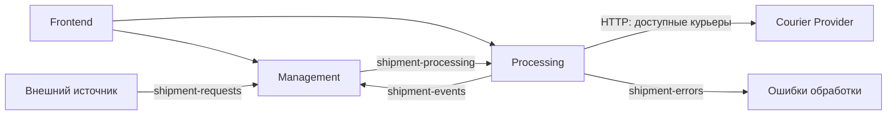

# Logistics Platform

Система управления доставками: Java 21, Spring Boot 4.1.2, Maven Wrapper,
PostgreSQL, Kafka, Keycloak, Liquibase и Resilience4j. Интерфейс — Vue 3 и Vite,
в Docker раздаётся через Nginx. Интерфейс частично создан с помощью ИИ.

## Запуск

Нужны Docker и Docker Compose. Перед первым запуском:

```bash
cp .env.example .env
docker compose up -d
```

Демонстрационные настройки уже заполнены. При первом запуске Compose соберёт образы,
PostgreSQL создаст базы и пользователей, Liquibase применит миграции, Kafka получит
топики и ACL, Keycloak импортирует realm с клиентами, ролями и пользователями.
Дождитесь `healthy` у сервисов; завершение `kafka-init` с кодом 0 — штатное поведение.
Файл `.env` остаётся локальным и не коммитится; в Git хранится только `.env.example`.

| Компонент | Локальный адрес |
| --- | --- |
| Frontend | http://localhost:5173 |
| Shipment Management | http://localhost:8081 |
| Shipment Processing | http://localhost:8082 |
| Courier Provider | http://localhost:8083 |
| Keycloak | http://localhost:8080 |
| PostgreSQL / Kafka | `localhost:5432` / `localhost:9092` |

Пользователи приложения: `rinat`, `sofia`, `admin`. Пароль по умолчанию — `demo-password`
(`DEMO_USER_PASSWORD` в `.env`). В Keycloak Admin Console используется отдельный пароль
`KEYCLOAK_ADMIN_PASSWORD`. USER видит свои заявки и задачи; ADMIN — все, статистику и retry.

Для проверки создайте заявку через «Новая заявка» → «Заполнить пример». Статусы обновляются
каждые 5 секунд. После назначения курьера EXPRESS занимает 30–90 секунд, STANDARD — 2–5 минут.
Данные сохраняются в named volumes; существующий realm повторно не импортируется.

```bash
docker compose ps                       # состояние сервисов
docker compose logs -f shipment-processing
# После изменения кода:
docker compose up -d --build
```

## Архитектура и данные

Каждый backend имеет отдельную БД и роль PostgreSQL. Взаимодействие браузера с API идёт
через Nginx; авторизация — Keycloak Authorization Code + PKCE и Bearer JWT.

| Сервис | Ответственность | Основные таблицы |
| --- | --- | --- |
| A — `shipment-management` | Приём через REST/Kafka, владельцы, основной бизнес-статус | `shipments`, `shipment_events`, `outbox_messages` |
| B — `shipment-processing` | Задачи, выбор и назначение курьера, маршрут, завершение доставки | `processing_tasks`, `processing_task_events`, `courier_assignments`, `route_sheets`, `outbox_messages` |
| C — `courier-provider` | Имитация внешней системы: сведения о курьерах, доступность, ошибки и задержки | `couriers` |

В заявке хранятся владелец, адреса, вес, габариты, тип доставки, статус и даты. Адреса
и габариты — JSONB. Задача содержит уникальный `shipmentId`, доверенный `ownerId`, снимок
данных заявки, статус, этап, попытки и время следующего выполнения. Назначение связывает
заявку с курьером; маршрут хранит адреса и расчётное время доставки. История сохраняет переходы,
outbox — сообщения для публикации. Между БД нет внешних ключей: используются UUID.



Процесс: регистрация `CREATED` → обработка и поиск курьера → `IN_TRANSIT` → `DELIVERED`.
Если курьера нет, задача ждёт в `WAITING_FOR_COURIER`; после 5 минут поиска — `COURIER_NOT_FOUND`.
Технические ошибки имеют ограниченные повторы, после исчерпания — `FAILED`.
ADMIN может возобновить задачи `FAILED` и `COURIER_NOT_FOUND`.

Ключевые решения:

- Изменение состояния, история и outbox сохраняются одной транзакцией. Доставка сообщений
  допускает дубли: B защищён уникальным `shipmentId`, A — идентификатором события и номером перехода.
  Внешние заявки защищены уникальной парой `sourceId` + `messageId`.
- Consumer регистрирует задачу; бизнес-обработку выполняет ограниченный Executor.
  Scheduler выбирает задачи по `nextExecutionAt`. Ожидание курьера и доставки хранится в БД,
  состояние восстанавливается после перезапуска. Блокировки, версия задачи и уникальные
  индексы активных назначений защищают от конкурирующих worker.
- B запрашивает C по HTTP с таймаутами и сервисным токеном `client_credentials`.
  C не назначает курьеров; занятость по нашим назначениям учитывает B.
- Resilience4j повторяет временные ошибки при приёме Kafka-сообщений с backoff 1/2/4 секунды.
  Невалидные и не обработанные после повторов сообщения уходят в DLQ; если её публикация
  не удалась, offset не фиксируется. Повторы самих задач планируются отдельно в PostgreSQL.

## Kafka-контракты

Команды и события передаются в JSON, версия прикладных контрактов `schemaVersion: 1`.
`shipmentData` содержит `origin`, `destination`, `weight`, `dimensions`, `deliveryType`.
Полные типы и валидация находятся в пакетах `kafka` соответствующих сервисов.

| Топик | Направление | DTO и основные поля |
| --- | --- | --- |
| `shipment-requests` | Внешний источник → A | `ExternalShipmentRequest`: `messageId`, `sourceId`, `shipmentData` |
| `shipment-processing` | A → B | `ShipmentProcessingCommand`: `messageId`, `shipmentId`, `correlationId`, `createdAt`, `ownerId`, `shipmentData` |
| `shipment-events` | B → A | `ShipmentProcessingEvent`: `eventId`, `shipmentId`, `eventType`, `timestamp`, `correlationId`, `sequenceNumber`, `payload` со статусом, этапом и результатом |
| `shipment-errors` | B → диагностический топик | `ShipmentProcessingError`: те же поля события; `payload` содержит `taskId`, `currentStage`, `attempts`, `details` |
| `shipment-dlq` | Consumers A/B → DLQ | Исходное сообщение и Kafka-заголовки с данными об ошибке и исходном топике |

Для команд обработки и событий Kafka key — `shipmentId`; для внешнего входа — `sourceId:messageId`.
Kafka использует SASL/PLAIN и ACL: отдельные учётки сервисов и `partner-demo` с правом записи
только в `shipment-requests`. A принимает `sourceId: partner-demo`, владельца определяет сам
как `external:partner-demo`; такие заявки доступны ADMIN. Для ручной отправки доступен
`infra/kafka/external-producer.sh`, принимающий строки `key<TAB>JSON` через stdin.

## API и настройка

Все бизнес-endpoints требуют JWT. Основные пути:

| Сервис | API |
| --- | --- |
| A | `POST /api/v1/shipments`, `GET /api/v1/shipments`, `GET /api/v1/shipments/{id}`, `GET /api/v1/shipments/{id}/events` |
| B | `GET /api/v1/tasks`, `GET /api/v1/tasks/{id}`, `GET /api/v1/tasks/{id}/events`, `GET /api/v1/tasks/statistics`, `POST /api/v1/tasks/{id}/retry` |
| C | `GET /api/v1/couriers`, `GET /api/v1/couriers/available`, `GET /api/v1/couriers/{id}` |

Списки заявок и задач поддерживают фильтры, сортировку и пагинацию. Каждый backend имеет
`GET /api/v1/status` и healthcheck `/actuator/health`.
Примеры запросов: [examples/requests.http](examples/requests.http). Для IntelliJ HTTP Client:

```bash
cp examples/http-client.private.env.json.example examples/http-client.private.env.json
```

Выберите окружение `local`; шаблон уже содержит демонстрационный пароль.
При своём `DEMO_USER_PASSWORD` синхронизируйте `demoPassword` в локальном файле.

Compose передаёт адреса БД, Kafka, C и Keycloak вместе с паролями из `.env`.
Настройки Executor, ожидания, повторов и симуляции находятся в `application.yml` сервисов.
Keycloak-конфигурация — `infra/keycloak/logistics-realm.json`. Отдельный сервис с его
зависимостями запускается через `docker compose up -d <имя-сервиса>`.

Для запуска backend из IDEA подключите корневой `.env` к конфигурации запуска соответствующего
Application. Локальные адреса уже заданы в `application.yml`; Docker-контейнер этого сервиса
предварительно остановите. Для разработки frontend отдельно:

```bash
docker compose stop frontend
cd frontend
npm ci
npm run dev
```

Нужен Node.js 24. Unit-тесты ключевых бизнес-правил запускаются с Java 21, без Docker:

```bash
./mvnw test
```
